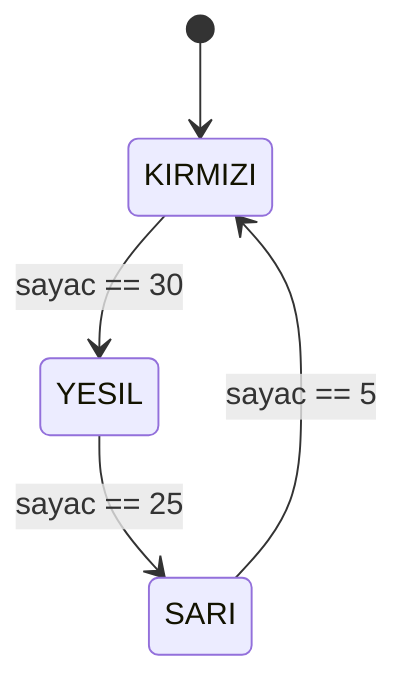
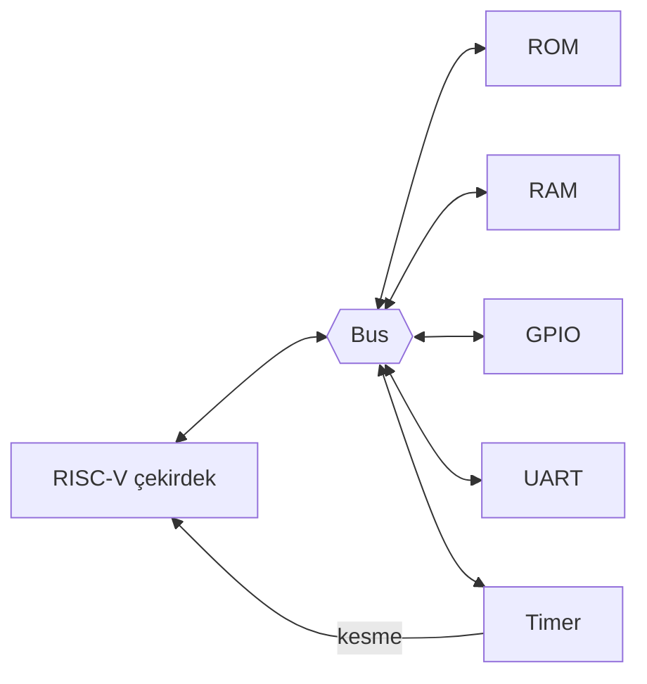

# Çizim rehberi

Claude Code bir terminal veya masaüstü uygulamasıdır; sohbetteki gibi doğrudan resim çizemez. Ama çizimi **metinden üreten araçlarla** çok iyi çalışır. Claude çizimin kaynağını (metin) yazar, araç onu resme çevirir, sen VS Code'da veya tarayıcı panelinde görürsün.

## Hangi çizim için hangi araç?

| Ne çizilecek? | Araç | Nerede görülür? | Kurulum |
|---|---|---|---|
| Blok diyagramı, durum diyagramı (FSM), akış şeması | **Mermaid** | VS Code Markdown önizlemesi, GitHub | VS Code 1.121 ve sonrasında yerleşik, ek kurulum yok |
| Zamanlama diyagramı (saat, sinyaller, bus el sıkışması) | **WaveDrom** | HTML sayfası, VS Code eklentisi | HTML'de CDN ile; ek kurulum gerekmez |
| Kendi Verilog'unun kapı/blok şeması | **Yosys + netlistsvg** | SVG dosyası | OSS CAD Suite (Yosys) + Node.js (`npm install -g netlistsvg`) |
| Elle kapı devresi, doğruluk tablosu | **schemdraw** (Python) | SVG/PNG dosyası | `pip install schemdraw` |
| Simülasyon dalga formu | **GTKWave** veya VS Code'da **VaporView** | Ayrı pencere veya VS Code | OSS CAD Suite / VS Code eklentisi |
| Hepsini tek sayfada, etkileşimli | **HTML sayfası** | Claude Code masaüstü uygulamasının tarayıcı paneli | Yok |
| Devreyi elle kurup tıklayarak denemek | **Digital** (hneemann) | Ayrı uygulama | Java gerekir (isteğe bağlı) |

## 1. Mermaid: blok ve durum diyagramları

Markdown dosyasının içine yazılır. VS Code'da dosyayı açıp `Ctrl+Shift+V` ile önizleme açınca çizim olarak görünür. GitHub'da da otomatik çizilir.

Durum diyagramı örneği (trafik ışığı FSM'i):



Blok diyagramı örneği (SoC):



## 2. WaveDrom: zamanlama diyagramları

JSON benzeri kısa bir metinle saat ve sinyalleri çizer. Örnek (bir bus yazma işlemi):

```json
{ "signal": [
  { "name": "clk",   "wave": "p......" },
  { "name": "valid", "wave": "0.1..0." },
  { "name": "ready", "wave": "0...10." },
  { "name": "addr",  "wave": "x.=..x.", "data": ["0x1000"] },
  { "name": "data",  "wave": "x.=..x.", "data": ["0xAB"] }
]}
```

Görüntülemenin en kolay yolu: Claude bu metni bir HTML sayfasına koyar (bkz. 5. madde). VS Code içinde görmek istersen "WaveDrom" eklentisi de kullanılabilir.

## 3. Yosys + netlistsvg: kendi kodunun şeması

Senin yazdığın Verilog modülünü otomatik olarak şemaya çevirir. "Kodum aslında hangi devreye dönüştü?" sorusunun cevabı. Özellikle istenmeyen latch'leri ve gereksiz mantığı görmek için çok faydalı.

Kullanım (`araclar/sema.sh` betiği bunu tek komuta indirir):

```bash
./araclar/sema.sh rtl/alu.v alu
# Çıktı: cizimler/alu.svg
```

Arka planda yaptığı:

```bash
yosys -p "read_verilog rtl/alu.v; prep -top alu; write_json cizimler/alu.json"
netlistsvg cizimler/alu.json -o cizimler/alu.svg
```

Not: Büyük modüllerde şema karmaşıklaşır. Küçük modüller (MUX, ALU dilimi, FSM) için kullan.

## 4. schemdraw: elle kapı devresi

Henüz Verilog'a dökülmemiş bir Boole ifadesini kapılarla çizmek için. Python betiğidir; Claude betiği `cizimler/` altına yazar, çalıştırır, SVG üretir.

```python
import schemdraw
from schemdraw.parsing import logicparse

d = logicparse('(a and b) or (not c)', outlabel='y')
d.save('cizimler/ornek_ifade.svg')
```

## 5. HTML sayfası: hepsini birlikte görmek (önerilen)

Claude Code **masaüstü uygulamasında** sohbette bir HTML dosyasının yoluna tıklayınca dosya uygulamanın **tarayıcı panelinde** açılır. Bu yüzden konu anlatımlarında Claude şunu yapar:

1. `cizimler/konu-XX-<ad>.html` dosyası oluşturur.
2. İçine Mermaid diyagramlarını, WaveDrom zamanlama diyagramlarını ve üretilen SVG şemalarını koyar.
3. Sohbette dosya yolunu verir; sen tıklayınca yan panelde açılır.

Gerekirse sayfa etkileşimli de olabilir: örneğin giriş anahtarlarına tıklayınca kapı çıkışlarının değiştiği küçük bir devre.

Terminalden çalışıyorsan aynı dosyayı çift tıklayarak normal tarayıcında açabilirsin.

## 6. Digital: tıklayarak devre kurma (isteğe bağlı)

Lojik devreleri sürükle-bırak ile kurup canlı simüle edebildiğin eğitim amaçlı bir uygulama. Devreyi Verilog'a da aktarabiliyor. Konu 1-5 arasında kavramları "elle hissetmek" için faydalı. Java gerektirdiği için kurulumu isteğe bağlı.

## Claude için kurallar

- Her konu anlatımında **en az bir çizim** olsun.
- FSM anlatırken durum diyagramı (Mermaid) + zamanlama (WaveDrom) birlikte verilsin.
- Öğrencinin kendi modülünü anlatırken önce netlistsvg şeması üretilsin, konuşma şema üzerinden yürüsün.
- Çizim kaynak dosyaları `cizimler/` altında, konuya göre adlandırılsın: `konu-05-trafik-isigi.html`.
