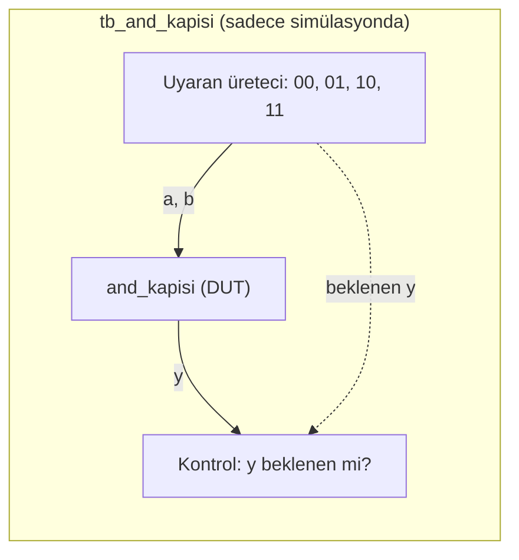
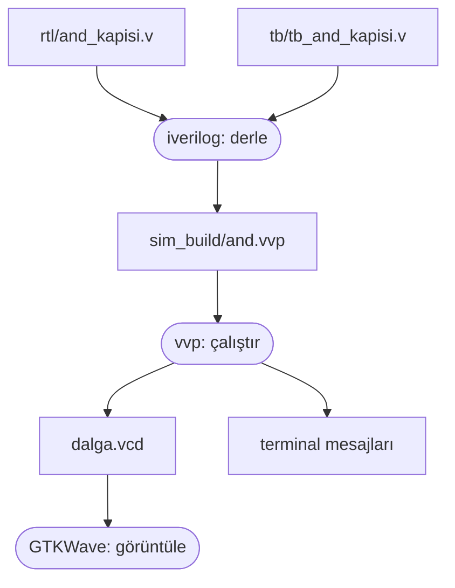

# Konu 0 — Kurulum ve ilk simülasyon

> Bir devreyi tasarlamak için önce onu çalıştırıp görebileceğin bir ortam gerekir. Bu konuda, yazdığın her şeyin dalga formunu görebileceğin düzeni kuruyoruz.

## Ana fikir (kendi cümlelerimle)

<Bu konuyu tek paragrafta, kendi cümlelerinle.>

## Ders notları

### Ders 1 — 2026-11-11

Çizimler: [`cizimler/konu-00-kurulum.html`](../../cizimler/konu-00-kurulum.html) (etkileşimli AND kapısı, testbench yapısı, simülasyon akışı, beklenen dalga formu)

**1. Verilog bir program değil, bir devre tarifidir.**
- Python'da satırlar sırayla çalışır. Verilog'da her satır bir devre parçasıdır ve hepsi aynı anda çalışır.
- Bir kablonun değeri, onu süren kapının girişi değiştiği an değişir.
- Gerçek çip üretmeden devrenin doğru olup olmadığını görmenin yolu **simülasyon**dur.

**1b. Donanım tanımlama dilleri (HDL: Hardware Description Language).** Yüz binlerce kapıyı elle çizmek imkânsız; devre metinle tarif edilir, araçlar metni simüle eder ve kapılara çevirir (sentez).
- Kesin bir sayı yok; onlarca dil var. Sanayi standardı üç tane: **Verilog** (IEEE 1364), **SystemVerilog** (IEEE 1800, Verilog'un üst kümesi), **VHDL** (IEEE 1076).
- Üst seviye diller (HLS C/C++, Chisel, SpinalHDL, Amaranth) doğrudan çip olmaz; **Verilog üretir**.
- Verilog: kısa, öğrenmesi hızlı; tip denetimi zayıf, hatalar sessiz geçebilir. SystemVerilog: tasarım + doğrulamanın (UVM) ana dili. VHDL: güçlü tip denetimi, uzun yazım; Avrupa, savunma, FPGA.
- **Neden Verilog?** Şartname Verilog/SystemVerilog/VHDL'e izin veriyor (§4.1) ve AXI (Advanced eXtensible Interface, bus kuralları) doğrulamasında SystemVerilog + UVM (Universal Verification Methodology, standart doğrulama yöntemi) istiyor (§4.1, §4.2.2.1). Verilog → SystemVerilog yolu ikisini de karşılar. Açık kaynak araçlar, hazır RISC-V çekirdekleri ve ana kaynağımız da Verilog.

**2. AND kapısı:** Çıkış ancak bütün girişler 1 ise 1 olur. 2 giriş → 2 × 2 = 4 kombinasyon → doğruluk tablosu 4 satır.

| a | b | y |
|---|---|---|
| 0 | 0 | 0 |
| 0 | 1 | 0 |
| 1 | 0 | 0 |
| 1 | 1 | 1 |

**3. Testbench:** Test edilen devreyi (DUT: Device Under Test) içine alan, sadece simülasyonda var olan ikinci bir Verilog modülü.
- Girişlere sırayla uyaran verir (sinyal üreteci gibi).
- Çıkışı beklenen değerle karşılaştırır, yanlışsa hata yazar (osiloskop + kontrol listesi gibi).
- Tasarımla **aynı anda** yazılır: testbench'i olmayan devre için "çalışıyor" denemez; hata devre küçükken yakalanırsa ucuzdur.

**4. Simülasyon akışı:**

Şemayı okurken: kutulardaki yazılar **dosya yolu** (`rtl/and_kapisi.v` = `rtl` klasöründeki `and_kapisi.v` dosyası; `.v` Verilog uzantısı) veya **program adı**dır.

| Kutu | Ne? | Kim yapar? |
|---|---|---|
| `rtl/and_kapisi.v` | Tasarım dosyası (çipe dönüşecek kısım) | Sen yazarsın |
| `tb/tb_and_kapisi.v` | Testbench dosyası (çipe dönüşmez) | Sen yazarsın |
| `iverilog` | Derleyici (Icarus Verilog): okur, yazım hatalarını bulur, model üretir | Program |
| `sim_build/and.vvp` | Derlenmiş model (insan okumaz) | `iverilog` üretir |
| `vvp` | Simülatör: modeli zamanda ilerletir (açılım resmî değil; yaygın yorum: Verilog Virtual Processor) | Program |
| terminal çıktısı | Testbench mesajları: geçti / hata | `vvp` yazar |
| `dalga.vcd` | Dalga kaydı (Value Change Dump) | `vvp` yazar |
| `GTKWave` | Dalga görüntüleyici | Program |

Klasörler: `rtl/` = tasarım (RTL: devreyi "veri hangi işlemden geçip hangi hafıza hücresine gidiyor" seviyesinde tarif etmek), `tb/` = testbench'ler, `sim_build/` = simülasyon ara dosyaları (git'e girmez).

**5. Araçlar kuruldu (2026-11-11):** OSS CAD Suite (iverilog, vvp, GTKWave, Yosys) `C:\Users\burak\tools\oss-cad-suite` altında; `bin` ve `lib` klasörleri **PATH**'e eklendi. PATH = Windows'un "programları şu klasörlerde ara" listesi; terminal açılırken okunur, kurulumdan sonra terminal yeniden açılmalı. netlistsvg npm ile kuruldu. Çalıştırma: `iverilog -o sim_build/and.vvp rtl/and_kapisi.v tb/tb_and_kapisi.v` → `vvp sim_build/and.vvp` → `gtkwave sim_build/dalga.vcd`.

**Kendime sorduğum soru:** Dalga formunda y neden yalnızca son aralıkta 1? → Çünkü y yalnızca a ve b birlikte 1 iken 1 olur; bu da yalnızca 30-40 ns aralığında oluyor.

### Ders 2 — 2026-11-25

Çizimler: aynı sayfanın 8. bölümü (modül = pinli çip kutusu şeması, NOT kapısı testbench dalga formu). Örnek kod: [`ornekler/degil_kapisi.v`](ornekler/degil_kapisi.v), [`ornekler/tb_degil_kapisi.v`](ornekler/tb_degil_kapisi.v) (simülasyonda `TEST GECTI`; kapı bozulunca `TEST KALDI: 2 hata`).

**6. Modül:** Her devre bir modüldür = pinli bir çip kutusu. Üç soru: adı ne, pinleri ve yönleri ne (`input`/`output`), çıkış girişlerden nasıl çıkıyor.
- `wire` = kablo, değer saklamaz. `assign y = ~a;` = sürekli atama, bir lehim gibi: a değişince y o an değişir.
- Kapı işaretleri: `~` NOT, `&` AND, `|` OR, `^` XOR.
- `` `timescale 1ns/1ps `` = `#1` 1 ns (nanosaniye) demek, hesap 1 ps (pikosaniye) hassasiyetinde.

**7. Testbench'in parçaları:**
- Pinsiz modül (en dıştaki kutu). `reg` = değer tutan değişken (girişi testbench sürer), `wire` = DUT'un sürdüğü çıkış.
- `degil_kapisi dut (.a(a), .y(y));` = örnekleme (instance): modül kalıbından bir çip basıp pinleri adıyla bağlamak.
- `initial begin … end` = simülasyonda bir kez, sırayla çalışan blok; `#10` = 10 ns bekle.
- `$` ile başlayanlar sistem görevleri (simülatöre emir): `$dumpfile`/`$dumpvars` dalga kaydı, `$display` yazdırma, `$finish` bitirme.
- `1'b1` = 1 bit, ikili, değeri 1. `!==` x (bilinmiyor) değerini de hata sayar; `!=` kaçırır.
- İyi testbench'in ölçüsü: **bozuk devrede kalmalı**.

**8. AND kapısı yazıldı ve incelendi:**
- `task` = testbench'te tekrarlanan adımları tek isimde toplar; içinde `#10` olabildiği için zaman da harcar.
- **Cevap anahtarı tasarımdan bağımsız olmalı.** İlk sürümde beklenen değer `va & vb` ile, yani tasarımla aynı formülle hesaplanıyordu: AND yanlış anlaşılsaydı iki yer birlikte yanlış olur, test yine geçerdi (sınavı kendi cevap anahtarınla okumak gibi). Düzeltme: beklenen değerler doğruluk tablosundan `dene(1, 1, 1)` biçiminde verildi.
- Ölçüm: doğru kapıda `TEST GECTI`; beş bozuk kapıda (`|`, `^`, `a`, `0`, NAND) testbench kaldı.
- Task'a giriş eklenip çağrılar güncellenmeyince `iverilog` "Missing argument 3" verdi: tanım ile çağrı birbirini tutmalı; simülasyon hiç başlamaz.

## Kendi sorularım

- <Anlamadığım veya merak ettiğim şeyler>
